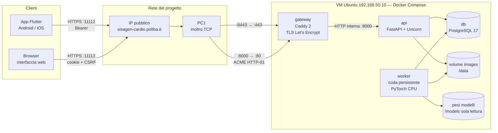
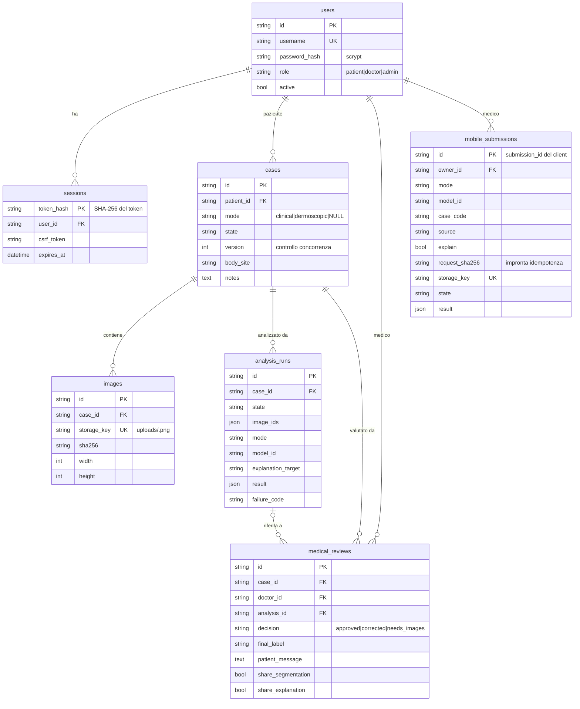
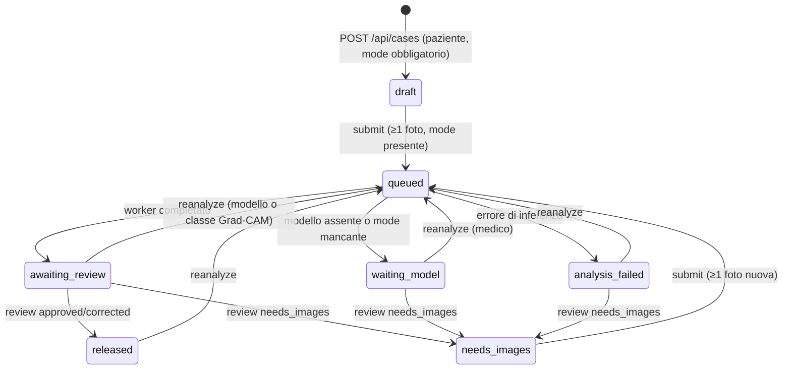
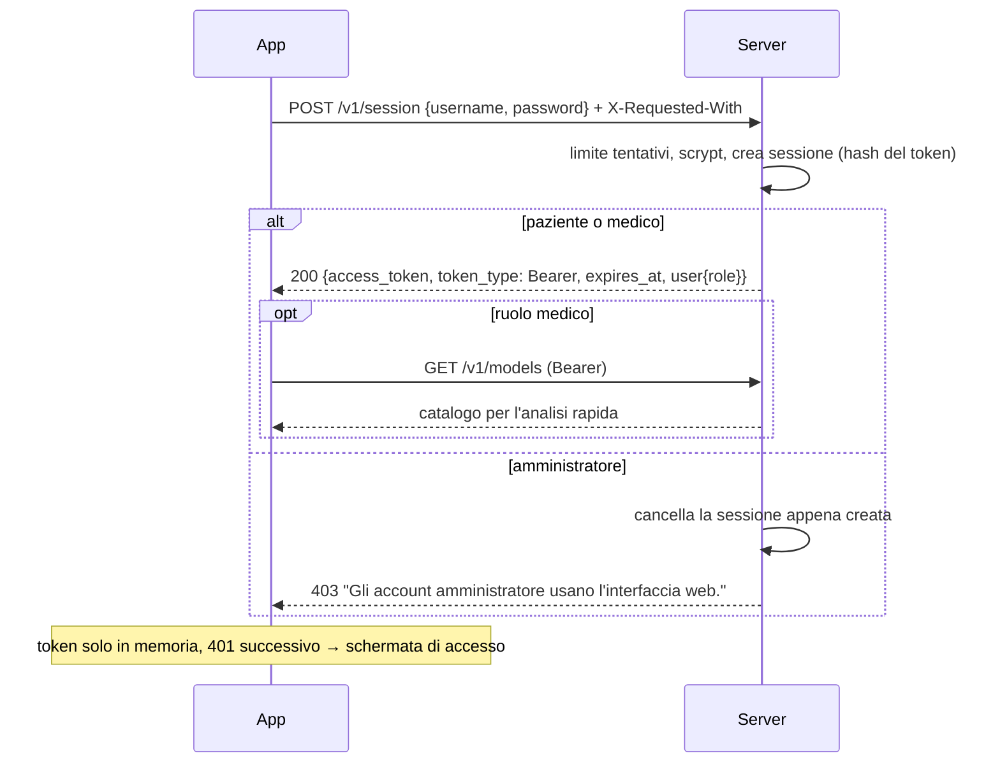
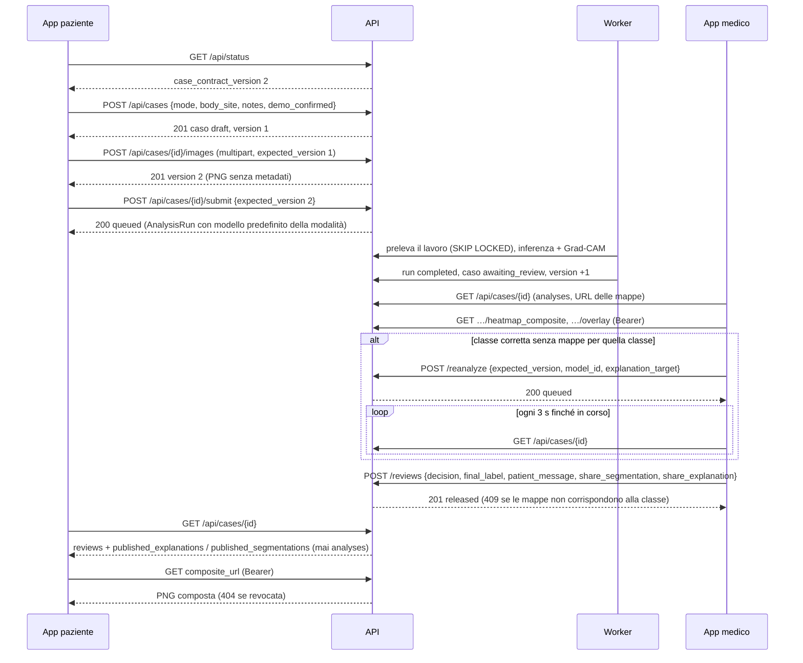
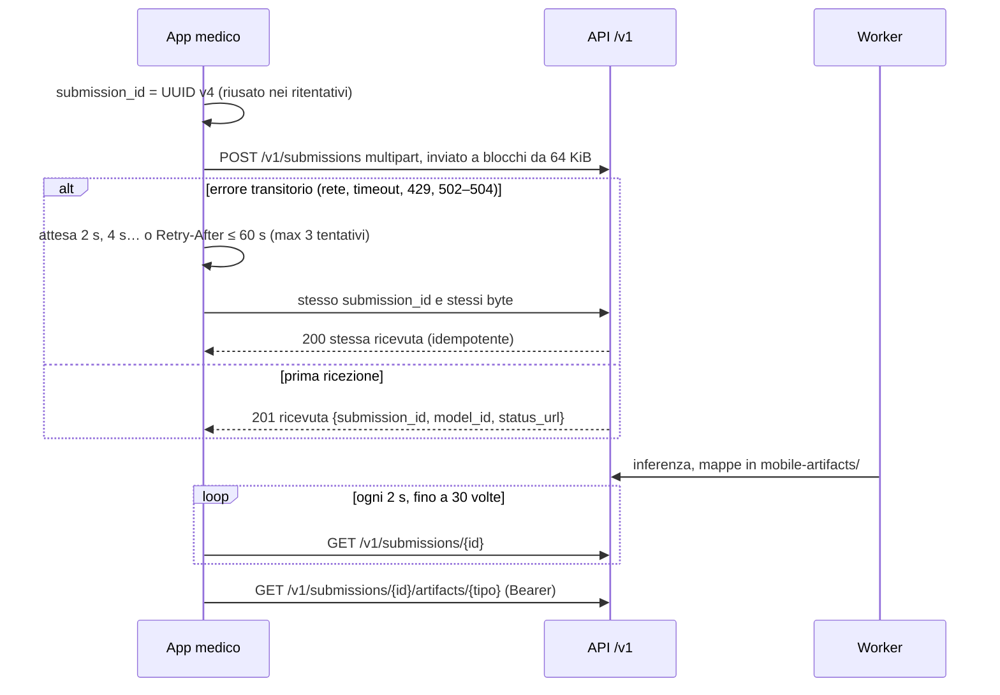
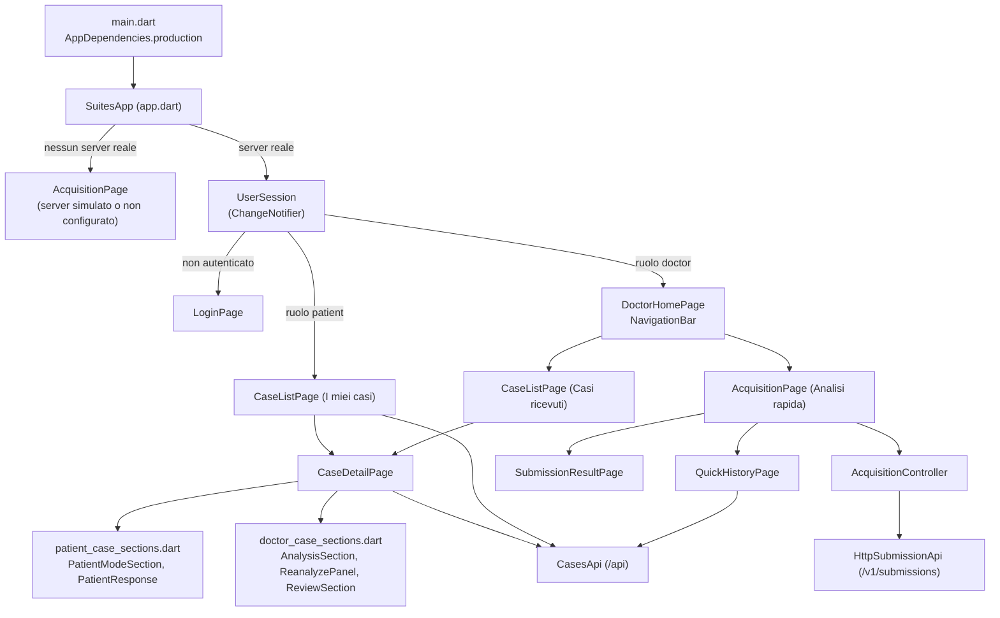

# Relazione tecnica — SUI.T.E.S., caso studio di teledermatologia

| | |
|---|---|
| Repository | `LabInfInd/suites-teledermatologia`, ramo `main` |
| Data | 16 novembre 2026 |
| Componenti | Server FastAPI con interfaccia web (`server/`), app Flutter Android/iOS (`mobile/`) |
| Istanza | `https://sisagen-cardio.poliba.it:11112` |
| Stato | Prototipo di ricerca con soli dati di prova; non validato per uso clinico |

Questa relazione descrive l'intero sistema così com'è nel codice del ramo `main`: architettura, rete e installazione, server, modelli e Grad-CAM, interfaccia web, app, protocollo di comunicazione, sicurezza, verifiche eseguite e limiti noti. Le specifiche normative di dettaglio restano nei documenti a cui la relazione rimanda: [`server/docs/CASE_GRADCAM.md`](../server/docs/CASE_GRADCAM.md) (contratto 2 dei casi), [`server/docs/API_MOBILE.md`](../server/docs/API_MOBILE.md) (API mobile) e [`docs/api-contratto-proposta.md`](api-contratto-proposta.md) (contratto condiviso).

## Indice

1. [Scopo e principi](#1-scopo-e-principi)
2. [Architettura generale](#2-architettura-generale)
3. [Rete, installazione ed esercizio](#3-rete-installazione-ed-esercizio)
4. [Server](#4-server)
5. [Modelli, segmentazione e Grad-CAM](#5-modelli-segmentazione-e-grad-cam)
6. [Interfaccia web](#6-interfaccia-web)
7. [Comunicazione client-server](#7-comunicazione-client-server)
8. [App Flutter](#8-app-flutter)
9. [Sicurezza e privacy](#9-sicurezza-e-privacy)
10. [Verifiche eseguite](#10-verifiche-eseguite)
11. [Limiti noti e lavoro futuro](#11-limiti-noti-e-lavoro-futuro)
12. [Appendice: mappa dei file](#12-appendice-mappa-dei-file)

---

## 1. Scopo e principi

Il sistema permette a un paziente di inviare foto di una lesione cutanea, a modelli di classificazione di analizzarle e a un medico di valutare il caso e decidere che cosa comunicare. A questo si aggiunge un'**analisi rapida** riservata al medico: una singola foto con risultato sperimentale immediato.

Principi che attraversano tutto il codice:

- **Nessuna diagnosi automatica.** Il paziente non riceve mai punteggi o analisi del modello. Vede solo ciò che il medico pubblica: testo, classe comunicata e, con consenso esplicito, mappe Grad-CAM e/o segmentazione.
- **Percorsi di acquisizione distinti.** Le foto `clinical` (smartphone, anche macro) e quelle `dermoscopic` (dermatoscopio o adattatore) usano modelli e classi diversi, senza conversioni tra le due tassonomie. La modalità è dichiarata da chi acquisisce, mai dedotta dai pixel.
- **Minimo dato.** Il server riscrive ogni foto come PNG senza metadati. L'app rimuove la posizione GPS dai JPEG prima dell'invio, non salva le foto sul telefono e non scrive log.
- **Autorizzazione lato server.** Ogni regola di visibilità e di stato è applicata dal server; i client si limitano a non chiedere ciò che non serve.
- **Integrità dei modelli.** Pesi verificati con SHA-256, architetture in una lista chiusa, nessun codice o percorso fornito dai client.

## 2. Architettura generale

| Servizio | Immagine | Ruolo |
|---|---|---|
| `gateway` | `caddy:2` | Termina TLS, ottiene e rinnova il certificato con ACME HTTP-01, limita il corpo a 43 MB, inoltra ad `api:8000`. Su HTTP risponde solo a `/health` e reindirizza (308) a HTTPS sulla 11112. |
| `api` | `telederm-app:local` (Python 3.12) | Applicazione FastAPI: API `/api` (web e casi), `/v1` (mobile), pagina web statica. |
| `worker` | stessa immagine | Unico processo di inferenza: preleva dal database i lavori in coda di casi e analisi rapide. |
| `migrate` | stessa immagine | Esegue `alembic upgrade head` e termina; `api` e `worker` partono solo se termina con codice 0. |
| `db` | `postgres:17-bookworm` | Database; volume `database`. |

Non ci sono broker di messaggi: la coda è una tabella con prelievo `SELECT … FOR UPDATE SKIP LOCKED`. I file (foto normalizzate, maschere, mappe) stanno nel volume `images`; il database conserva solo chiavi relative, impronte e metadati.

## 3. Rete, installazione ed esercizio

### 3.1 Percorso di rete

| Ingresso pubblico | Destinazione | Funzione |
|---|---|---|
| TCP 80 | PC1 → VM `192.168.50.10:8000` → `gateway:80` | Verifica ACME HTTP-01 e rinnovi del certificato |
| TCP 11112 | PC1 → VM `192.168.50.10:8443` → `gateway:443` | Traffico HTTPS di app e web |

Il TLS non viene decifrato da PC1: termina nel `gateway`. TLS-ALPN-01 è disattivato, quindi la porta pubblica 443 non serve. Il certificato è emesso per il nome host e usato sulla porta 11112. Profilo attivo: `compose.yaml` + `compose.https-11112-http01.yaml`, selezionato da `COMPOSE_FILE` nella `.env` della VM. I dettagli sono in [`server/docs/HTTPS_11112_HTTP01.md`](../server/docs/HTTPS_11112_HTTP01.md).

Nel profilo HTTPS, `api`, `worker` e `migrate` ricevono:
- `APP_ORIGINS=https://sisagen-cardio.poliba.it:11112`;
- `COOKIE_SECURE=true`;
- `HTTP_DEMO_ORIGINS` vuoto.

`api` è pubblicata solo su `127.0.0.1:8001`.

### 3.2 Contenitori e indurimento

- **Immagine:** `python:3.12-slim-bookworm`, con PyTorch 2.7.1 / torchvision 0.22.1 CPU e le dipendenze bloccate (`requirements.txt`, `model_integration/requirements.txt`).
- **Utente:** non privilegiato `10001:10001`.
- **Opzioni comuni a `api`, `worker` e `migrate`:**
  - filesystem `read_only` con `/tmp` in `tmpfs` (128 MB);
  - `cap_drop: [ALL]` e `no-new-privileges`;
  - `init: true`;
  - log `json-file` con rotazione (3 file da 10 MB).
- **Uvicorn:** avviato con `--no-proxy-headers --no-access-log`, quindi senza log di accesso con URL o indirizzi.
- **Pesi dei modelli:** montati in sola lettura su `/models`.
- **Healthcheck:**
  - `db`: `pg_isready`;
  - `api`: GET `/ready`, che esegue `SELECT 1`;
  - `worker`: esistenza di `/tmp/telederm-worker.ready`, creato solo dopo il caricamento e la verifica dei modelli installati.

### 3.3 Configurazione

Le variabili d'ambiente sono lette in `server/app/config.py` e validate all'avvio.

| Variabile | Default | Regole |
|---|---|---|
| `DATABASE_URL` | SQLite locale | In Compose: PostgreSQL con password da `.env`. |
| `DATA_DIR` | `.local/data` | `/data` nel contenitore. |
| `APP_ORIGINS` | localhost:8001/8080 | Origini complete senza percorso. Fuori da localhost serve HTTPS, salvo eccezione esplicita. |
| `HTTP_DEMO_ORIGINS` | vuoto | Solo `http://`, sottoinsieme di `APP_ORIGINS`, richiede `COOKIE_SECURE=false`. Ammesso solo per prove con immagini sintetiche. |
| `COOKIE_SECURE` | `true` | Con HTTP di rete è ammesso solo per le origini dichiarate in `HTTP_DEMO_ORIGINS`. |
| `SESSION_HOURS` | 8 | Intervallo 1–24. |
| `MODEL_ADAPTER` | `disabled` | `disabled` oppure `python`. |
| `MODEL_DIR` | `model_integration/weights` | `/models` nel contenitore. |
| `MODEL_THREADS` | 4 | Intervallo 1–16 (thread di PyTorch). |
| `MODEL_CATALOG_FILE` | catalogo interno | Facoltativo, catalogo esterno. |

Limiti fissi (`Settings`): 4 foto per caso, 40 MiB per foto, 25 megapixel per le foto dei casi. Gli invii rapidi hanno limiti propri: 40 MiB e 80 MP.

### 3.4 Installazione, account, backup

- **Installazione:**
  1. `scripts/configure_vm.py` crea una `.env` con password PostgreSQL casuale, permessi 0600, e non sovrascrive mai un file esistente;
  2. `docker compose up -d --build`;
  3. i pesi dei modelli si copiano a mano in `model_integration/weights/`: non sono in Git.
- **Account** (`python -m app.manage`):
  - comandi `create-user --username … --role patient|doctor|admin`, `reset-password`, `migrate`, `init-demo`;
  - le password si inseriscono solo da terminale e non esistono account predefiniti;
  - l'amministratore può creare account anche dal web.
- **Backup** (`scripts/backup.sh`):
  - ferma `api` e `worker` per avere un'istantanea coerente;
  - esegue `pg_dump -Fc`, crea il tar del volume immagini e calcola i `SHA256SUMS`;
  - un marcatore `INCOMPLETO` resta finché il backup non è completo;
  - alla fine riavvia i servizi, anche in caso di errore (`trap`).
- **Aggiornamenti e rollback:** prima del rilascio si fa un backup verificato con SHA-256, si conserva la versione precedente e si applicano migrazioni solo additive. In caso di rollback il worker precedente resta fermo, così non elabora casi con il percorso vecchio (vedi [`server/docs/VERIFICATION.md`](../server/docs/VERIFICATION.md)).

## 4. Server

### 4.1 Stack

FastAPI 0.162, Starlette 1.10, Uvicorn 0.54, SQLAlchemy 2.1, psycopg 3.3, Alembic 1.20, Pydantic 2.14, Pillow 13 con `pillow-heif` 1.8, NumPy 2.1, OpenCV headless 4.11, Albumentations 2.0, timm 1.0.15, PyTorch 2.7.1 CPU. Documentazione OpenAPI disattivata (`docs_url`, `redoc_url` e `openapi_url` a `None`).

### 4.2 Modello dei dati

Gli identificativi sono UUID v4 in forma di stringa. Le date sono in UTC senza fuso nel database e serializzate in ISO 8601 con suffisso `Z`.

Altre tabelle: `login_attempts` (tentativi di accesso per chiave hash, conservati 15 minuti) e `audit_events` (attore, azione, identificativo dell'oggetto, data). Indici di coda: `(state, created_at)` su `analysis_runs` e su `mobile_submissions`.

**Migrazioni Alembic:**
1. `de0293a5f46d`: schema iniziale.
2. `20261113_mobile`: tabella `mobile_submissions`.
3. `20261114_case_explanations`: migrazione additiva che aggiunge `cases.mode`, `analysis_runs.mode`, `analysis_runs.model_id`, `analysis_runs.explanation_target` e `medical_reviews.share_explanation` (default `false`). I casi storici restano con `mode = NULL`, senza attribuzione automatica a `dermoscopic`.

### 4.3 Stati del caso

**Versioni.** Ogni modifica del caso incrementa `version` e aggiorna `updated_at`. Le scritture richiedono `expected_version`: se non coincide, il server risponde 409 senza modificare nulla. Anche il worker incrementa la versione quando conclude un'analisi.

Le analisi (`analysis_runs.state`) passano per `queued → running → completed | waiting_model | failed`. Le analisi rapide (`mobile_submissions.state`) per `queued → running → completed | failed`.

### 4.4 Autenticazione e sessioni

- **Password:** scrypt (N=16384, r=8, p=1, 32 byte, sale casuale di 16 byte), confrontate in tempo costante. Lunghezza 12–256 caratteri per i nuovi account.
- **Login** (`POST /api/login`, condiviso da `POST /v1/session`):
  - **limite di tentativi:** al massimo 8 per coppia (nome utente, indirizzo IP) in 15 minuti, poi 429 con `Retry-After: 900`; il conteggio è serializzato da un lock;
  - **enumerazione degli utenti:** un utente inesistente viene comunque verificato contro un hash fittizio, così i tempi non rivelano quali utenti esistono;
  - **pulizia:** le sessioni scadute vengono eliminate; un'eventuale sessione precedente dello stesso browser viene sostituita.
- **Sessione:**
  - il token è `secrets.token_urlsafe(32)`; nel database si salva solo il suo SHA-256;
  - a ogni sessione è associato un token CSRF; la scadenza è `SESSION_HOURS`.
- **Web:**
  - cookie `telederm_session` con flag `HttpOnly`, `Secure` (nel profilo HTTPS), `SameSite=Strict` e `Path=/`;
  - le richieste che non sono GET, HEAD o OPTIONS richiedono `X-CSRF-Token`.
- **App:**
  - `POST /v1/session` restituisce lo stesso token come `access_token` di tipo `Bearer`, insieme a `expires_at` e ai dati dell'utente; è ammesso solo per `patient` e `doctor`;
  - per un `admin` la sessione appena creata viene cancellata e il server risponde 403;
  - quando c'è l'intestazione `Authorization`, `current_user` usa solo quel token: senza ripiegare sul cookie e senza controllo CSRF, perché il browser non allega quell'intestazione da solo;
  - `DELETE /v1/session` revoca il token.
- **Ruoli:** `require_role` restituisce 403 «Operazione non consentita per questo account». Un caso di un altro paziente, o una bozza vista da un medico, restituisce 404, così non se ne rivela l'esistenza.

### 4.5 Middleware di sicurezza

`SafetyMiddleware` (`server/app/middleware.py`) agisce prima del parser di FastAPI:

1. **Host:** fuori da `/health` e `/ready`, l'intestazione `Host` deve corrispondere a una delle `APP_ORIGINS`; altrimenti 400.
2. **Scritture** (metodi diversi da GET, HEAD e OPTIONS) su `/api` e `/v1`:
   - `/api` richiede `X-Requested-With: Telederm`;
   - un `Origin` presente deve essere tra le origini configurate;
   - `Sec-Fetch-Site: cross-site` viene rifiutato.
3. **Limite del corpo,** applicato anche ai trasferimenti chunked, con il corpo bufferizzato prima del parser multipart:
   - 40 MiB + 64 KiB su `/v1/submissions`;
   - `max_upload_bytes` + 64 KiB sui percorsi `…/images`;
   - 64 KiB altrove;
   - oltre il limite: 413.
4. **Intestazioni su ogni risposta:**
   - `X-Content-Type-Options: nosniff`;
   - `Referrer-Policy: no-referrer`;
   - `X-Frame-Options: DENY`;
   - `Permissions-Policy` che nega fotocamera, microfono e posizione;
   - una `Content-Security-Policy` restrittiva (`default-src 'self'`, nessuno script inline, `frame-ancestors 'none'`);
   - `Cache-Control: no-store` su `/api`, `/v1` e sulla pagina.
5. **Formato degli errori:**
   - sotto `/v1`: `{"error":{"code","message"}}`;
   - sotto `/api`: `{"detail": "..."}`;
   - per la validazione di `/api` si aggiunge `errors: [{field, message}]`, senza mai riportare i valori inviati (che potrebbero contenere password o note).

### 4.6 Trattamento delle immagini

`normalize_image` (`server/app/imaging.py`) è usata per le foto dei casi e degli invii rapidi:

1. **Controllo iniziale:**
   - foto non vuota ed entro il limite di byte;
   - formato tra JPEG, PNG, WebP e HEIC/HEIF, riconosciuto da Pillow e non dall'estensione;
   - un solo fotogramma;
   - almeno 32 px per lato, al massimo 25 MP (80 MP per gli invii rapidi);
   - `DecompressionBombWarning` trattato come errore;
   - verifica dell'integrità del file (`verify()`).
2. **Orientamento:** applicazione dell'orientamento EXIF (`exif_transpose`).
3. **Colore:** conversione del profilo ICC in sRGB, se presente. La trasparenza viene composta su fondo bianco, poi tutto passa in RGB.
4. **Ricostruzione:** l'immagine viene ricreata dai soli pixel (`Image.frombytes`) e salvata in PNG, senza EXIF, GPS, commenti né nome originale.
5. **Impronta:** calcolo dello SHA-256 della PNG risultante.

I file vanno in `uploads/<uuid>.png` (casi) o `mobile/<uuid>.png` (invii rapidi). `storage_path` rifiuta percorsi fuori da `DATA_DIR`. Se la transazione fallisce, il file appena scritto viene cancellato.

Per gli invii rapidi il server controlla anche che il `Content-Type` dichiarato corrisponda al formato reale (415), e scrive il file con `O_EXCL` più `fsync` prima del commit.

### 4.7 API dei casi (`/api`)

Ogni endpoint richiede l'autenticazione (cookie e CSRF dal web, Bearer dall'app).

| Metodo e percorso | Ruolo | Corpo | Esito |
|---|---|---|---|
| `GET /api/status` | tutti | — | `case_contract_version: 2`, `acquisition_modes`, `max_images`, `max_upload_mb` |
| `GET /api/cases?offset=&search=` | paziente (i propri), medico (non bozze) | — | `items`, `total`, `counts` per stato; pagine da 50 |
| `POST /api/cases` | paziente | `{mode, body_site, notes, demo_confirmed:true}` | 201, dettaglio. Senza `mode`: 422 |
| `GET /api/cases/{id}` | proprietario o medico | — | Dettaglio filtrato per ruolo (§4.8) |
| `PATCH /api/cases/{id}/acquisition` | paziente | `{expected_version, mode}` | 200. Ammesso in bozza; con `needs_images` solo per confermare una modalità mancante; altrimenti 409 |
| `POST /api/cases/{id}/images` | paziente | multipart `expected_version`, `file` | 201. Solo in `draft`/`needs_images`; al massimo 4 foto |
| `DELETE /api/cases/{id}/images/{image_id}` | paziente | `{expected_version}` | 200. Solo in bozza |
| `GET /api/cases/{id}/images/{image_id}` | proprietario o medico | — | PNG, `no-store` |
| `POST /api/cases/{id}/submit` | paziente | `{expected_version}` | 200. Accoda un'analisi con il modello predefinito della modalità; senza modalità 409; con `needs_images` serve almeno una foto nuova |
| `GET /api/models?mode=` | medico | — | Catalogo (§5.1); paziente e admin 403 |
| `POST /api/cases/{id}/reanalyze` | medico | `{expected_version, mode?, model_id?, explanation_target?}` | 200, asincrono (§4.9) |
| `POST /api/cases/{id}/reviews` | medico | `{expected_version, decision, final_label, patient_message, share_segmentation, share_explanation}` | 201 (§4.10) |
| `GET /api/cases/{id}/analyses/{run}/images/{image}/{kind}` | medico; paziente solo se pubblicato | — | PNG `no-store`; `kind` ∈ `mask`, `overlay`, `heatmap`, `heatmap_overlay`, `heatmap_composite` |
| `GET /api/mobile-submissions[?offset=]`, `/{id}`, `/{id}/artifacts/{kind}` | medico proprietario | — | Storico delle analisi rapide (§4.12) |
| `GET /api/me`, `POST /api/logout`, `POST /api/me/password` | tutti | — | Sessione web e cambio password; il cambio revoca le altre sessioni |
| `GET/POST/PATCH /api/admin/users`, `GET /api/admin/audit` | amministratore | — | Gestione account (la disattivazione revoca le sessioni) e registro |

### 4.8 Visibilità del dettaglio del caso

Tutti i ruoli autorizzati ricevono: `id`, `code` (`TD-<anno>-<8 caratteri>`), `mode`, `body_site`, `state`, `version`, `image_count`, `created_at`, `updated_at`, `notes`, `images[]` (`id`, `width`, `height`, `url`) e `reviews[]` (`id`, `decision`, `final_label`, `patient_message`, `share_segmentation`, `share_explanation`, `analysis_id`, `doctor`, `created_at`).

- **Solo il medico:**
  - `patient_code`;
  - `analyses[]`, dalla più recente. Ogni analisi ha `id`, `state`, `mode`, `model_id`, `explanation_target`, `failure_code` e i tempi.
  - Per ogni foto dell'analisi: `image_id`, `input_sha256`, `classification` (`model_name`, `model_version`, `labels[{label, score}]`), `segmentation_available`, `mask_url`/`overlay_url` (nulli senza segmentazione), `explanation` (`method`, `target_class`, `status`, metadati) e `heatmap_url`, `heatmap_overlay_url`, `heatmap_composite_url`.
- **Solo il paziente:** `published_segmentations[]` e `published_explanations[]`, calcolati da `published_maps` sull'**ultima** valutazione. Sono vuoti se:
  - l'ultima valutazione non è `approved` o `corrected`;
  - l'analisi collegata non è completata o non appartiene al caso;
  - la modalità del caso è cambiata rispetto all'analisi.

  Ogni spiegazione pubblicata contiene `image_id`, `analysis_id`, `review_id`, `method`, `target_class` (uguale a `final_label`), `status`, `heatmap_url`, `overlay_url` (RGBA), `composite_url` (RGB già composto) e `warning`, un testo fisso del server.

**Le mappe al paziente** sono servite da `read_artifact` con lo stesso criterio: l'ultima valutazione deve corrispondere all'analisi e serve il consenso (`share_segmentation` per `mask` e `overlay`; `share_explanation` più la mappa pronta per la classe finale per i tre tipi Grad-CAM). Altrimenti 404. Una nuova valutazione senza consenso rende quindi inaccessibili anche gli URL già noti.

### 4.9 Nuova analisi (reanalyze)

- **Stati ammessi:** `waiting_model`, `analysis_failed`, `awaiting_review`, `released`; con `queued` o una versione obsoleta: 409.
- **Modalità:** `mode` vale quella inviata oppure quella del caso; se manca: 409.
- **Modello:** `model_id` vale quello inviato; altrimenti quello dell'analisi precedente se della stessa modalità; altrimenti il predefinito della modalità. Un modello sconosciuto o incompatibile restituisce 400.
- **Classe da spiegare:** `explanation_target`, se presente, deve essere un'etichetta del catalogo della modalità (altrimenti 400); se è assente, ogni foto spiega la propria classe predetta.
- **Esito:** il caso passa a `queued` con un nuovo `AnalysisRun`, e la modalità del caso viene aggiornata. Ricalcolare la mappa non cambia la classificazione, che viene ricalcolata identica dagli stessi pesi.

### 4.10 Valutazione del medico

- **Richiesta di nuove foto** (`needs_images`):
  - ammessa negli stati `awaiting_review`, `waiting_model` e `analysis_failed`, e solo con meno di 4 foto;
  - non deve contenere etichetta né consensi (altrimenti 400).
- **Conferma o correzione** (`approved` o `corrected`):
  - **analisi:** serve `awaiting_review` con l'ultima analisi completata, modalità del caso presente e uguale a quella dell'analisi, e `model_id` registrato; altrimenti 409;
  - **etichetta:** `final_label` è obbligatoria; con `approved` deve essere tra le classi predette in prima posizione, altrimenti 400;
  - **segmentazione:** condividerla richiede maschere su tutte le foto, altrimenti 400; un classificatore clinico non segmenta;
  - **Grad-CAM:** condividerla richiede, su **tutte** le foto, `method = gradcam`, `target_class == final_label`, stato `available` o `no_positive_signal` e i tre file presenti in archivio; altrimenti 409 e nessuna pubblicazione. La condivisione resta facoltativa (default `false`) e indipendente dalla segmentazione.
- **Messaggio al paziente:** 10–5000 caratteri.
- **Registrazione:** la valutazione registra `analysis_id` dell'ultima analisi completata.

### 4.11 API mobile (`/v1`)

| Metodo e percorso | Ruolo | Note |
|---|---|---|
| `POST /v1/session` | paziente, medico | JSON `{username, password}`; risposta `{access_token, token_type:"Bearer", expires_at, user}` |
| `DELETE /v1/session` | paziente, medico | 204, revoca |
| `GET /v1/models?mode=` | medico | Catalogo |
| `POST /v1/submissions` | medico | Multipart (vedi sotto); 201 ricevuta, 200 se ripetuto identico |
| `GET /v1/submissions/{id}` | medico proprietario | Stato e risultato; artefatti come URL relativi |
| `GET /v1/submissions/{id}/artifacts/{kind}` | medico proprietario | `normalized_image`, `heatmap`, `heatmap_overlay`, `segmentation_mask`, `segmentation_overlay` |

**Campi multipart di `POST /v1/submissions`:**
- `submission_id`: UUID v4 canonico minuscolo;
- `mode`: `clinical` o `dermoscopic`;
- `case_code`: 3–40 caratteri `[A-Za-z0-9_-]`, che inizia con lettera o cifra; la struttura del codice fiscale è rifiutata;
- `source`: `camera`, `gallery` o `unknown`;
- `image`: un solo file;
- `model_id`: facoltativo;
- `explain`: default `true`.

Campi duplicati o sconosciuti restituiscono 422.

**Idempotenza.** L'impronta della richiesta è lo SHA-256 del JSON ordinato di `mode`, `case_code`, `source`, `model_id`, `explain` e dello SHA-256 dei byte originali. Lo stesso `submission_id` con la stessa impronta restituisce la stessa ricevuta con 200; con un'impronta diversa restituisce 409 `submission_conflict`. La concorrenza tra due richieste identiche è gestita con l'`IntegrityError` sulla chiave primaria.

**Altri controlli:**
- coda limitata a 100 invii in attesa o in esecuzione (429 con `Retry-After: 30`);
- modello non installato: 503;
- formato dichiarato diverso dal reale: 415;
- immagine non valida: 422;
- oltre 40 MiB: 413.

### 4.12 Storico web delle analisi rapide

`/api/mobile-submissions` riusa la serializzazione di `/v1`, sostituendo la base degli URL. L'elenco aggiunge `top_label` (etichetta con il punteggio massimo). Ogni consultazione è registrata nell'audit. Paziente e admin ricevono 403, un altro medico 404.

### 4.13 Worker

`python -m app.worker`:

1. **Unicità:** su PostgreSQL acquisisce il lock di sessione `pg_try_advisory_lock(734821905)`; un secondo worker si ferma con errore.
2. **Verifica dei modelli:** con `MODEL_ADAPTER=python` istanzia ogni modello installato del catalogo, verificando impronte e architettura, prima di dichiararsi pronto.
3. **Ripristino:** rimette in `queued` i lavori rimasti `running` dopo un arresto.
4. **Ciclo:**
   - alterna un lavoro dei casi (`process_one`) e uno delle analisi rapide (`process_mobile_one`);
   - se non c'è lavoro attende 2 secondi;
   - si ferma con SIGTERM o SIGINT (grazia di 60 secondi in Compose).

**Analisi di un caso (`process_one`):**
1. prende il lavoro `queued` più vecchio con `FOR UPDATE SKIP LOCKED` e lo marca `running`;
2. senza modalità o `model_id`: `waiting_model`, con `failure_code = acquisition_mode_required`;
3. per ogni foto chiama `predictor.predict(foto, explain=True, target_class=explanation_target)`, valida la classificazione con Pydantic e ordina le etichette per punteggio;
4. **segmentazione:** salva maschera e overlay, solo se il modello è dichiarato segmentante;
5. **Grad-CAM:** verifica che la mappa sia in scala di grigi (L), della stessa dimensione della foto, con `method` uguale a `gradcam` e la classe richiesta. Genera l'overlay RGBA colorato e la foto composta (`alpha_composite`). Salva tre PNG: `artifacts/<run>-<image>-heatmap.png`, `…-heatmap_overlay.png` e `…-heatmap_composite.png`;
6. **esito:**
   - successo: il caso va in `awaiting_review`;
   - modello assente: `waiting_model` (`model_unavailable`);
   - errore: `analysis_failed` (`inference_error`).

   In ogni caso la versione del caso aumenta, l'evento viene registrato nell'audit e, se l'analisi non è riuscita, i file già scritti vengono cancellati.

**Analisi rapida (`process_mobile_one`):**
- percorso analogo, con controllo che i punteggi siano finiti e compresi tra 0 e 1;
- mappe in `mobile-artifacts/<id>-<tipo>.png`; il risultato include `classification`, `segmentation`, `explanation`, `artifacts`, `image` e un avviso di uso solo per ricerca.

I log contengono solo il tipo dell'eccezione: mai immagini, token o note.

## 5. Modelli, segmentazione e Grad-CAM

### 5.1 Catalogo

Il catalogo è `server/model_integration/catalog.json`, con schema 1. Il codice (`registry.py`) verifica che:
- gli identificativi siano univoci;
- il backend sia `timm` o `ftn`;
- `ftn` corrisponda a `dermoscopic` e `timm` a `clinical`;
- ogni bundle sia dentro `MODEL_DIR`;
- ci sia un solo predefinito per modalità.

| `id` | Modalità | Backend | Bundle | Predefinito | Classi | Segmentazione |
|---|---|---|---|---|---|---|
| `clinical-convnextv2-tiny` | clinical | timm | `clinical-pad-v1` | sì | ACK, BCC, MEL, NEV, SCC, SEK | no |
| `clinical-dinov2-base` | clinical | timm | `clinical-dinov2-base-224-refit-20261113` | no | ACK, BCC, MEL, NEV, SCC, SEK | no |
| `dermoscopic-ftn` | dermoscopic | ftn | radice dei pesi | sì | AK, BCC, BKL, DF, MEL, NV, VASC | sì |

La voce pubblica del catalogo (`/api/models`, `/v1/models`) contiene: `id`, `name`, `mode`, `default`, `available` (presenza dei file), `classes`, `classification`, `segmentation`, `explanation: "gradcam"` e `intended_use: research_only_external_validation_required`.

Le classi dei due percorsi non sono equivalenti (SEK ≠ BKL, NEV ≠ NV) e il FTN disponibile non ha SCC. I pesi non sono in Git; le licenze sono documentate in [`server/README.md`](../server/README.md): PAD-UFES-20 CC BY 4.0, ConvNeXt derivato da pesi CC BY-NC 4.0, pretraining DINOv2 Apache-2.0.

### 5.2 Modelli clinici (timm)

`TimmClinical` (`registry.py`):

- **Manifest del bundle:** l'architettura deve essere `convnextv2_tiny.fcmae_ft_in22k_in1k` oppure `vit_base_patch14_dinov2.lvd142m`; classi e modalità devono essere quelle cliniche; l'ingresso deve essere 224×224 RGB con media e deviazione standard ImageNet, senza TTA.
- **Pesi:** si verifica lo SHA-256 dei pesi rispetto a `weights_sha256`; il caricamento usa `weights_only=True` e `strict=True`; nessun download durante l'inferenza.
- **Pre-elaborazione:**
  1. orientamento EXIF e conversione in RGB;
  2. padding quadrato centrato con colore (124, 116, 104);
  3. ridimensionamento a 224 bicubico con antialias;
  4. normalizzazione ImageNet.
- **Punteggi:** `softmax(logit / T)`, con temperatura scalare `T` dal manifest (0 < T < 100). I logit non finiti sono un errore.
- **Grad-CAM:**
  - livello: `stages[-1]` per ConvNeXt; `blocks[-1].norm1` per ViT, ricostruendo la griglia dei patch dopo aver tolto il token CLS;
  - il punteggio spiegato è il logit della classe prima della temperatura.

DINOv2 è un refit a 224 px su 1.472 immagini di sviluppo, con temperatura stimata su 357 immagini di calibrazione. Il test storico non è stato riaperto.

### 5.3 FTN dermatoscopico

`FTNPredictor` (`adapter.py`) e le architetture congelate in `ftn.py`:

- **Integrità:** gli SHA-256 di `ftn.py` e di `adapter.py` devono coincidere con quelli del manifest (`architecture_sha256`, `adapter_sha256`), così come gli SHA-256 dei due checkpoint (`CLASSIFICATION_5_auc.pth`, `Segm_model_Finale_ImageNet.pth`).
- **Classificazione:** ridimensionamento a 224×224 e normalizzazione ImageNet. La probabilità finale è la media dei softmax su 5 viste TTA: identità, ribaltamento verticale, ribaltamento orizzontale, entrambi, trasposizione.
- **Segmentazione:** CLAHE (clip 4.0, griglia 8×8), ridimensionamento a 512×512 e normalizzazione; `argmax` sulle due classi, maschera 0/255 riportata alla dimensione originale con interpolazione nearest.
- **Profilo provvisorio:** pesi ImageNet, nessun pooling PSP; normalizzazione e ricetta storica sono da confermare con gli autori.
- **Grad-CAM:** sul livello `encoder.stem`, con il punteggio pari alla probabilità softmax della classe. Si calcola una mappa per ciascuna delle 5 viste, la si riallinea con la trasformazione inversa e si fa la media.

### 5.4 Algoritmo Grad-CAM

Implementazione in `server/model_integration/explain.py`:

1. un hook sul livello bersaglio cattura le attivazioni `A`;
2. il punteggio della classe bersaglio (logit, oppure probabilità per FTN) viene derivato rispetto ad `A`, ottenendo i gradienti `G`;
3. per i transformer (attivazioni con 3 dimensioni) si rimuove il token CLS e la sequenza dei patch viene riportata a griglia quadrata;
4. la mappa è `ReLU( Σ_c A_c · mean_xy(G_c) )`; valori non finiti sono un errore;
5. **ripristino geometrico** (`restore_cam`): ridimensionamento bilineare al lato del quadrato e ritaglio che inverte esattamente il padding (modelli clinici), oppure ridimensionamento diretto alla dimensione della foto (FTN);
6. **normalizzazione:** si tiene solo la parte positiva, divisa per il massimo dell'immagine, e si converte in 8 bit (0–255, PNG in scala di grigi). Se il massimo è circa zero la mappa è nulla e lo stato è `no_positive_signal`, che **non** significa assenza di lesione; altrimenti lo stato è `available`.

Le mappe hanno la stessa larghezza, altezza e orientamento della PNG normalizzata della foto.

**Rappresentazioni prodotte dal worker:**
- `heatmap`: scala di grigi (L), l'intensità;
- `heatmap_overlay`: RGBA con colormap continua blu → giallo → rosso. Per un valore normalizzato x ∈ [0,1]: R = clip(1,5 − |4x − 3|), G = clip(1,5 − |4x − 2|), B = clip(1,5 − |4x − 1|), alfa = 0,6·x, quindi trasparente dove l'attribuzione è nulla;
- `heatmap_composite`: RGB, la foto con l'overlay già composto, da mostrare **senza** sovrapporre di nuovo l'overlay;
- **segmentazione:** maschera L 0/255; overlay RGBA con colore (18, 157, 139) e alfa pari a 0,45 volte la maschera.

Grad-CAM può evidenziare bordi, sfondo o artefatti e non certifica la correttezza della previsione: non è un contorno, una probabilità per pixel o una segmentazione.

## 6. Interfaccia web

È una pagina singola in JavaScript senza framework (`server/app/static/index.html`, `app.js`, CSS), compatibile con la CSP: nessuno script inline, nessuna risorsa esterna. La navigazione usa l'hash dell'URL; le chiamate passano da `api()`, che allega `X-Requested-With` e `X-CSRF-Token`.

- **Login unico.** Dopo l'accesso la shell mostra la navigazione del ruolo.
- **Paziente:** «I miei casi» e «Nuovo caso», con modalità (`case-mode`), sede, note, conferma dei dati di prova e caricamento fino a 4 file. Prima di caricarli il browser controlla numero e dimensione dei file. Il dettaglio mostra stato e avvisi, la galleria, la risposta del medico e le sole mappe pubblicate.
- **Medico:**
  - «Casi ricevuti» con filtri e conteggi, e il dettaglio con analisi del modello, controlli di nuova analisi (modalità, modello, classe), valutazione con consensi e conferma prima della pubblicazione, e aggiornamento automatico durante l'analisi;
  - «Analisi rapide»: elenco e dettaglio degli invii fatti dall'app.
- **Amministratore:** account (creazione, sospensione, riattivazione) e registro di audit.
- **Coerenza della modalità:** l'invio del caso è bloccato se la modalità selezionata nella pagina differisce da quella salvata (commit `9fc9b00`).

## 7. Comunicazione client-server

### 7.1 Regole comuni

- **Trasporto:** solo HTTPS verso `https://sisagen-cardio.poliba.it:11112`, con validazione normale di certificato e nome host. HTTP è ammesso solo per prove locali o esplicitamente dichiarate (§3.3), e l'app lo rifiuta nelle build release.
- **Autenticazione dell'app:** `Authorization: Bearer <token>` su ogni richiesta autenticata, e `X-Requested-With: Telederm` su ogni richiesta che non sia GET (login e logout compresi). Nessun cookie, `Origin` o CSRF.
- **Concorrenza:** ogni scrittura su un caso porta `expected_version` e usa sempre la `version` dell'ultima risposta; un 409 impone di ricaricare il caso.
- **Cache:** tutte le risposte API e le PNG sono `no-store`. Le PNG si scaricano solo con il token e solo da percorsi relativi riconosciuti.
- **Codici di stato:**
  - 400: regola di dominio violata;
  - 401: sessione assente o scaduta;
  - 403: ruolo, origine o intestazione;
  - 404: oggetto inesistente o non visibile;
  - 409: conflitto o stato non consentito;
  - 413: dimensione;
  - 415: formato;
  - 422: validazione;
  - 429: troppi tentativi o coda piena;
  - 503: modello non installato.

### 7.2 Accesso

### 7.3 Caso del paziente fino alla risposta

### 7.4 Analisi rapida del medico

### 7.5 Gestione degli errori nell'app

| Situazione | Comportamento dell'app |
|---|---|
| 401 su `/api` o `/v1` | `UserSession.expire()`: il token viene cancellato e si torna al login, senza ulteriori chiamate |
| 409 su un caso | Mostra il messaggio del server e ricarica il caso; non ritenta da sola. La bozza della valutazione resta |
| 404 su una mappa | La mappa viene sostituita da «non più disponibile», senza riprovare lo stesso URL. Durante un download il caso viene ricaricato |
| 400 o 422 | Mostra `detail` (oppure `error.message` su `/v1`) |
| Errori di rete, TLS, timeout | Messaggi specifici. Le richieste dei casi hanno timeout di 30 s (2 minuti per il caricamento di una foto, 60 s per le immagini) |
| Analisi rapida | Ritentativi automatici solo per gli errori transitori, con lo stesso identificativo; le altre classi di errore hanno un messaggio dedicato |

I messaggi del server sono sempre decodificati in UTF-8 dai byte della risposta: FastAPI non dichiara il charset e la decodifica predefinita (latin1) corromperebbe le lettere accentate.

## 8. App Flutter

### 8.1 Stack e configurazione

Dart 3.13.4, Flutter 3.47.5 (ambiente verificato). Dipendenze dirette: `http`, `http_parser`, `image_picker`, `share_plus` 13.3.1, `flutter_localizations`, `cupertino_icons`. Interfaccia solo in italiano, tema derivato dal blu del logo (`#126393`).

La configurazione è letta a build time (`AppConfig.fromEnvironment`):

- `SUITES_API_BASE_URL`: URL assoluto `https` (oppure `http` solo in debug o profile), senza credenziali, query o frammento.
- `SUITES_SIMULATED_SERVER` e `SUITES_SIMULATED_SCENARIO`: server simulato interno, non combinabile con un URL reale e rifiutato in release.

Se la configurazione non è valida l'app si avvia lo stesso, ma segnala «Server non configurato» e non invia nulla. Esempi: `config/server.example.json`, `config/server.sisagen.example.json`.

### 8.2 Architettura del codice

| Livello | File | Responsabilità |
|---|---|---|
| Rete | `lib/src/api/user_session.dart` | Login e ruolo, token in memoria, catalogo `/v1/models` (solo medico), stato e artefatti degli invii rapidi, logout e scadenza |
| | `lib/src/api/cases_api.dart` | Tutti gli endpoint `/api`: stato, catalogo, casi, foto, modalità, nuova analisi, valutazione, storico rapido, immagini autenticate |
| | `lib/src/api/http_submission_api.dart` | Invio rapido con avanzamento, annullamento, timeout per inattività, ritentativi |
| | `lib/src/api/simulated_server.dart` | Server simulato (`success`, `flaky`, `offline`, `rejected`, `server_error`) |
| Dominio | `lib/src/domain/patient_case.dart` | `CaseState`, `CaseSummary`/`CaseDetails`, `CaseReview`, `CaseAnalysis`, `AnalysisImage`, `ExplanationInfo`, `PublishedExplanation`/`PublishedSegmentation`, `CatalogModel`, `ServerStatus` |
| | `acquisition_mode.dart`, `captured_photo.dart`, `case_code.dart`, `submission.dart` | Modalità, foto e formati, codice pseudonimo, richieste, ricevute ed errori dell'invio rapido |
| Acquisizione | `lib/src/capture/` | `image_picker`, preparazione della foto (formato, limite, GPS), lettura delle dimensioni |
| Interfaccia | `lib/src/ui/` | Schermate e widget; `case_widgets.dart` contiene stato, elenco e `CaseImageView` |

Le dipendenze passano dal costruttore (`AppDependencies`, `CaseServices`). Picker, ispettore delle immagini, client HTTP e condivisione si possono sostituire nei test.

### 8.3 Sessione

`UserSession.login`:
- invia `POST /v1/session` con `X-Requested-With`;
- interpreta 401 (credenziali), 429 (troppi tentativi) e 403 (mostra il messaggio del server, per esempio per l'amministratore);
- verifica `token_type = Bearer` e un token non vuoto;
- legge `user.role`: un ruolo diverso da `patient` o `doctor` fa revocare subito il token;
- solo per il medico carica il catalogo: se il caricamento fallisce, revoca il token.

Le intestazioni comuni sono `authorization`, `accept: application/json` e `x-requested-with: Telederm`. `logout()` revoca il token sul server, ma la sessione locale si chiude anche se la rete non risponde. `expire()` chiude la sessione senza contattare il server, dopo un 401. Il token non viene mai salvato su disco.

### 8.4 Client dei casi e protezione del token

`CasesApi`:

- **URL:** costruiti con `UserSession.endpoint()`, che conserva un eventuale prefisso di percorso nell'URL di base. I parametri di query passano separati, così `?` non viene codificato nel percorso.
- **Caricamento delle foto:** multipart con `expected_version` e `file`. Il nome del file è generico (`foto.<estensione>`), così il nome originale non lascia il telefono, e il `Content-Type` è ricavato dalla firma del file.
- **Immagini:** `image(path)` invia il token solo se il percorso corrisponde a `^/api/cases/<uuid>/(images/<uuid>|analyses/<uuid>/images/<uuid>/(mask|overlay|heatmap|heatmap_overlay|heatmap_composite))$`. Lo stesso vale in `UserSession.artifact()` per `/v1/submissions/<uuid>/artifacts/<tipo>`. URL assoluti o di altri percorsi vengono rifiutati senza alcuna richiesta.
- **Nuova analisi:** `reanalyze()` omette `model_id` ed `explanation_target` se nulli: omettere la classe significa spiegare la classe predetta.

### 8.5 Percorso del paziente

1. **I miei casi** (`CaseListPage`): elenco con stato, modalità, numero di foto e data; aggiornamento con trascinamento verso il basso; pulsante «Nuovo caso».
2. **Nuovo caso** (`NewCasePage`):
   - all'apertura chiama `GET /api/status`; se il contratto non è il 2, la creazione è bloccata («Server non aggiornato»);
   - la modalità si sceglie con `ModeSelector`, senza un valore predefinito: «Foto clinica» (smartphone normale, anche macro) o «Dermatoscopica» (dermatoscopio o adattatore);
   - sede e note sono facoltative; la conferma dei dati di prova è obbligatoria.
3. **Dettaglio** (`CaseDetailPage`):
   - **intestazione:** stato, sede, modalità e avviso dello stato;
   - **modalità** (`PatientModeSection`):
     - in bozza si cambia dopo una finestra di conferma, con `PATCH /acquisition`;
     - con `needs_images` e modalità mancante va confermata;
     - senza modalità l'invio è disattivato;
   - **foto:** griglia delle foto, rimovibili in bozza; «Fotocamera» e «Galleria» fino a 4; «Invia il caso al medico» (o «Invia di nuovo») dopo una conferma;
   - **risposta** (`PatientResponse`, nello stato `released`):
     - riquadro «Validato dal medico» con la classe comunicata e il messaggio;
     - le sole `published_explanations` della valutazione corrente (`review_id`): foto composta mostrata **senza** overlay aggiuntivo, classe spiegata, avvertenza del server, nota su `no_positive_signal` e pulsante «Scarica la foto con la mappa»;
     - la segmentazione pubblicata in una sezione separata, come foto più overlay;
     - nessun punteggio;
   - **storico:** comunicazioni del medico, con l'indicazione delle mappe condivise.

Il paziente non chiama mai `/api/models`, `/v1/models` o `/v1/submissions`.

### 8.6 Percorso del medico

`DoctorHomePage` ha due schede: **Casi ricevuti** e **Analisi rapida**. Il cambio di scheda è bloccato durante un invio rapido.

- **Casi ricevuti:** filtri «Da validare», «In attesa», «Pubblicati», «Tutti».
- **Dettaglio del caso:**
  - **analisi** (`AnalysisSection`): modalità, nome del modello (dal catalogo `/api/models?mode=` della modalità dell'analisi) e classe spiegata («classe predetta di ogni foto» se `explanation_target` è nullo). Per ogni foto (`AnalysisImageCard`):
    - selettore **Foto / Grad-CAM / Segmentazione**: la Grad-CAM mostra la `heatmap_composite` senza overlay; la segmentazione mostra la foto con l'overlay FTN ed esiste solo se il modello la produce;
    - modello e versione e le prime 3 classi con percentuale;
    - classe spiegata con il suo stato, e la nota su `no_positive_signal`;
  - **caso storico senza modalità:** un avviso dedicato. Il pannello «Nuova analisi» (`ReanalyzePanel`) si apre già espanso:
    - la modalità va scelta prima di poter avviare;
    - il modello viene dal catalogo (predefinito: quello precedente della stessa modalità, altrimenti il default del catalogo);
    - la classe da spiegare è «Classe predetta di ogni foto» oppure una classe del modello;
  - **valutazione** (`ReviewSection`):
    - **decisioni:** «Conferma classificazione» e «Correggi classificazione» se l'analisi è completata e la modalità coincide; «Richiedi nuove foto» se ci sono meno di 4 foto e lo stato lo consente;
    - **etichetta:** precompilata con la classe predetta; un'etichetta diversa passa automaticamente a «Correggi»;
    - **«Condividi la mappa Grad-CAM con il paziente»:** casella attivabile solo se `explanationReadyFor(final_label)` vale su tutte le foto (stessa condizione del server), e comunque disattivata finché il medico non la sceglie. Se la classe è nel catalogo ma le mappe spiegano un'altra classe, compare «Ricalcola Grad-CAM per «X»», che invia `reanalyze` con lo stesso modello ed `explanation_target = X`. Se la classe è fuori catalogo, la valutazione si pubblica solo come testo;
    - **«Condividi la segmentazione»:** casella separata, presente solo se tutte le foto hanno la segmentazione;
    - **conferma:** prima di pubblicare una finestra riepiloga il testo e i consensi;
  - **bozza** (`ReviewDraft`): decisione, etichetta, messaggio e consensi sono tenuti dalla pagina, quindi sopravvivono agli aggiornamenti. Mentre il caso è in coda la pagina si ricarica ogni 3 secondi (al massimo 100 volte); dopo una pubblicazione riuscita la bozza si azzera.

### 8.7 Analisi rapida

- **Flusso** (`AcquisitionPage` con `AcquisitionController`, un `ChangeNotifier`):
  1. tipo di acquisizione obbligatorio, con indicazioni specifiche;
  2. modello di ricerca, solo con server reale, dal catalogo filtrato per modalità;
  3. foto, con anteprima a schermo intero zoomabile;
  4. codice caso pseudonimo validato (struttura del codice fiscale rifiutata);
  5. invio, con avanzamento in byte e possibilità di annullare;
  6. ricevuta.

  Durante l'invio e dopo la conferma i dati sono bloccati. Dopo la conferma si può fare una nuova foto per lo stesso caso oppure un nuovo caso.
- **`HttpSubmissionApi`:**
  - corpo multipart trasmesso a blocchi da 64 KiB, con avanzamento;
  - un watchdog interrompe la richiesta dopo 30 secondi senza traffico;
  - la risposta letta è limitata a 64 KiB;
  - **ritentativi:** fino a 3 tentativi complessivi, solo per errori di rete, timeout, 429 e 502–504; attesa 2 s e poi 4 s, oppure `Retry-After` se non supera i 60 s;
  - lo stesso `submission_id` (UUID v4 generato sul telefono) viene riusato finché foto, modalità, modello e codice non cambiano; un 409 di conflitto azzera l'identificativo.
- **Risultato** (`SubmissionResultPage`): stato, classificazione, nota sul significato di Grad-CAM, scelta tra Grad-CAM e segmentazione FTN, foto normalizzata con l'overlay. Mentre l'analisi è in coda la pagina si ricarica ogni 2 secondi, fino a 30 volte.
- **Storico** (`QuickHistoryPage`): `/api/mobile-submissions` (prima pagina), con apertura del risultato.

### 8.8 Acquisizione e preparazione delle foto

- **Acquisizione:** `image_picker` apre la fotocamera posteriore di sistema o la galleria, senza `maxWidth`, `maxHeight` o `imageQuality`, quindi la foto non viene ridimensionata né ricompressa dall'app. Con `requestFullMetadata: false` iOS non chiede l'accesso all'intera libreria.
- **Lettura:** la foto viene letta in memoria e la copia temporanea del plugin viene cancellata subito.
- **Recupero su Android:** se il sistema chiude l'app mentre la fotocamera è aperta, la foto viene recuperata (`retrieveLostData`) e il tipo di acquisizione va riscelto.
- **Preparazione** (`preparePhoto`, comune a casi e analisi rapida):
  1. formato riconosciuto dalla firma del file: JPEG, PNG, WebP, HEIC (brand `heic`/`heix`/`heim`/`heis`/`hevc`/`hevx`), HEIF (`mif1`/`msf1`);
  2. limite di 40 MiB;
  3. rimozione della posizione dai JPEG (`removeLocationMetadata`): elimina la directory GPS dell'EXIF e i pacchetti XMP con coordinate, senza ricompressione, lasciando invariati i pixel, l'orientamento e gli altri metadati. Un JPEG non interpretabile resta invariato. Per gli altri formati la rimozione dei metadati spetta al server;
  4. lettura delle dimensioni con il motore di Flutter, con un avviso sotto i 1000 px di lato corto.
- **Errori di acquisizione:** permesso della fotocamera o delle foto negato, fotocamera assente, schermata già aperta, foto illeggibile, formato non supportato, foto troppo grande. Ognuno ha un messaggio dedicato.

### 8.9 Login, download e permessi

- **Login:**
  - pulsanti «Incolla», che tolgono spazi e a capo ai lati del testo;
  - incolla dal menu contestuale e compilazione automatica (`AutofillGroup`, `AutofillHints.username`/`password`);
  - pulsante «Mostra/Nascondi password»;
  - la password viene cancellata dopo ogni tentativo.
- **Download delle mappe:** la PNG composta viene scaricata con il token e passata a `share_plus` (`XFile.fromData`, nome `gradcam-<codice>-foto-<n>.png`). Il foglio di condivisione permette di salvarla in Foto o in File: è l'unico caso in cui l'app scrive un'immagine fuori dalla memoria.
- **Permessi Android:** solo `INTERNET`. Il permesso `CAMERA` non serve perché la fotocamera è quella di sistema.
- **Permessi iOS** (`Info.plist`): `NSCameraUsageDescription`, `NSPhotoLibraryUsageDescription` e `NSPhotoLibraryAddUsageDescription`, quest'ultimo per salvare la foto composta. Lingua `it` (`CFBundleLocalizations`), così anche le schermate di sistema sono in italiano.
- **Identificativi:** bundle identifier e `applicationId` `it.teledermatologia.teledermatologia`.

## 9. Sicurezza e privacy

| Rischio | Contromisura |
|---|---|
| Intercettazione | HTTPS con certificato pubblico; HTTP solo per prove dichiarate; l'app rifiuta HTTP in release |
| Furto di credenziali | scrypt; limite di 8 tentativi in 15 minuti; token casuale da 256 bit salvato solo come hash; scadenza 1–24 h; revoca su logout, disattivazione dell'account e cambio password |
| CSRF dal browser | Cookie `SameSite=Strict`, token CSRF per sessione, controllo di `Origin`, `Sec-Fetch-Site` e `X-Requested-With`; il Bearer non viene inviato automaticamente dal browser |
| Accesso a dati altrui | Proprietà verificata dal server; 404 per oggetti non visibili; bozze invisibili ai medici; l'amministratore non accede ai dati clinici |
| Esposizione di risultati non validati | Il paziente non riceve `analyses` né punteggi; le mappe solo con consenso esplicito e corrispondenza della classe; revoca automatica con una nuova valutazione |
| Metadati nelle foto | GPS rimosso nell'app (JPEG); il server ricostruisce la PNG dai soli pixel; nome del file generico |
| File malevoli | Formato verificato dal contenuto, limite di pixel con protezione dalle decompression bomb, limite del corpo prima del parser, un solo fotogramma |
| Esecuzione di codice tramite i modelli | Catalogo chiuso, architetture in lista, pesi verificati con SHA-256, `weights_only=True`, codice FTN sigillato con SHA-256 |
| Fuga del token dall'app | Token solo in memoria, inviato solo a percorsi relativi riconosciuti, mai nei log |
| Persistenza sul telefono | Foto in memoria; file temporanei cancellati; salvataggio solo su scelta del paziente |
| Tracce nei log | Nessun log di accesso in Uvicorn; il worker registra solo il tipo di errore; l'app non scrive log |
| Contenitori | Utente non privilegiato, filesystem in sola lettura, nessuna capability, pesi in sola lettura |

**Dati di prova.** L'istanza contiene solo dati sintetici e account di prova: la conferma `demo_confirmed` è obbligatoria a ogni creazione di caso. Il repository GitHub è pubblico e non contiene credenziali, pesi, database, foto o backup.

## 10. Verifiche eseguite

### 10.1 App (16/11/2026, ramo `main`)

- `flutter analyze`: nessun problema.
- `flutter test`: **110 test superati**, con un server in memoria che applica le regole del contratto 2 (`test/support/fake_platform_server.dart`), senza richieste di rete. Coprono:
  - **sessione:** ruoli, admin rifiutato, catalogo solo per il medico, UTF-8, incolla e autocompletamento nel login;
  - **richieste:** campi JSON e multipart; `Authorization` e `X-Requested-With` su scritture e download; assenza di cookie, `Origin` e CSRF; URL non riconosciuti mai contattati;
  - **casi:** modalità obbligatoria, server senza contratto 2, casi storici, PATCH della modalità;
  - **ruoli:** isolamento, divieto del catalogo al paziente, nessuna analisi o punteggio al paziente;
  - **mappe:** prima e dopo la pubblicazione, revoca con 404, nessun doppio overlay della foto composta, segmentazione separata;
  - **valutazione:** ricalcolo per la classe corretta, bozza conservata durante l'aggiornamento automatico, consensi indipendenti;
  - **errori:** 401, 409 e 422;
  - **analisi rapida:** invio multipart, ritentativi, `Retry-After`, annullamento, timeout, avanzamento, server simulato, recupero della foto, GPS su JPEG sintetici, formati, codice caso.
- `flutter build ios --profile`: riuscita. App installata su iPhone 14 Pro (iOS 27.2.1) e provata a mano sull'istanza HTTPS, con esito positivo nei flussi principali di paziente e medico.
- **Prova sull'istanza reale:** i client dell'app hanno eseguito sul server vero il percorso completo con account di prova (contratto 1). Per il contratto 2 è stato eseguito uno smoke test HTTPS di sola lettura: contratto annunciato, catalogo per modalità, 403 al paziente sul catalogo, campi del dettaglio.
- **Android:** non compilato, perché l'SDK non è installato sul computer di sviluppo.

### 10.2 Server (dettaglio in [`server/docs/VERIFICATION.md`](../server/docs/VERIFICATION.md))

- **87 test superati, 0 saltati,** sia su Windows (Python 3.12.14) sia nell'immagine Docker Linux (Python 3.12.16), con i pesi reali dei tre modelli. Coprono, tra l'altro:
  - modalità obbligatoria e nessun ripiego verso FTN;
  - mappe allineate (L, RGBA, RGB);
  - consensi indipendenti e revoca degli URL;
  - il fatto che cambiare la classe spiegata non alteri i punteggi;
  - isolamento, CSRF, Bearer, idempotenza;
  - formati WebP e HEIC e limiti.
- La migrazione è stata provata su PostgreSQL 17 temporaneo con record sintetici.
- **Prove HTTPS sull'istanza reale,** con certificato e nome host verificati:
  - ciclo `clinical` con ConvNeXt, correzione con ricalcolo DINOv2 e pubblicazione Grad-CAM;
  - ciclo `dermoscopic` con FTN, segmentazione e Grad-CAM;
  - 409 sulla condivisione con una classe non coerente con le mappe;
  - 404 al paziente prima della pubblicazione;
  - login web dei tre ruoli, analisi rapida e storico.
- Tempi osservati su un'immagine sintetica (non è un benchmark): circa 2,3 s per ConvNeXt e DINOv2, circa 5,4 s per FTN.

Queste verifiche sono software e su immagini sintetiche: **non misurano accuratezza né validità clinica** di classificazioni e mappe.

## 11. Limiti noti e lavoro futuro

- **Validazione clinica:** serve una coorte indipendente di pazienti, telefoni e condizioni di acquisizione prima di qualunque uso con pazienti reali. Il profilo FTN di segmentazione è provvisorio e va confrontato con la ricetta di addestramento.
- **Android:** build, fotocamera e galleria (HEIC compreso), recupero della foto, icona adattiva, `applicationId` e firma release sono da completare e verificare.
- **Prove sui telefoni:**
  - permessi negati e riattivati;
  - salvataggio della foto composta in Foto;
  - foto da 48 MP o più (memoria e limite di 25 MP dei casi);
  - comportamento macro e adattatore dermatoscopico;
  - cambio di rete e app sospesa durante un invio, che non prosegue in background.
- **Paginazione nell'app:** elenco dei casi e storico rapido mostrano solo la prima pagina (50 elementi). La ricerca disponibile sul server non è esposta nell'app.
- **Sessione dell'app:** il token è solo in memoria, quindi chiudendo l'app si deve rifare l'accesso. Un'eventuale conservazione in Keychain o Keystore va decisa e progettata.
- **Notifiche:** l'app non riceve notifiche; lo stato si aggiorna all'apertura o durante l'aggiornamento automatico.
- **Dimensionamento:** il worker è unico ed esegue l'inferenza in sequenza su CPU, e la coda rapida è limitata a 100 invii. Il carico reale va misurato.
- **Licenze e diritti:** i pesi ConvNeXt derivano da una licenza non commerciale. La licenza del codice del repository non è ancora definita (repository pubblico senza licenza).
- **Logo:** il logo è provvisorio, e gli identificativi tecnici vanno decisi prima della pubblicazione negli store.

## 12. Appendice: mappa dei file

| Percorso | Contenuto |
|---|---|
| `server/app/main.py` | Applicazione FastAPI, endpoint web, casi e amministrazione, gestori degli errori |
| `server/app/mobile_api.py` | Endpoint `/v1`: sessione, catalogo, invii rapidi, stato, artefatti |
| `server/app/web_submissions.py` | Storico web delle analisi rapide |
| `server/app/case_analysis.py` | Serializzazione delle analisi, regole di pubblicazione delle mappe |
| `server/app/security.py` | Password, sessioni, `current_user` (cookie o Bearer), ruoli, audit |
| `server/app/middleware.py` | Host, origine, intestazioni, limiti del corpo, intestazioni di sicurezza |
| `server/app/imaging.py` | Normalizzazione delle foto, archivio, maschere |
| `server/app/worker.py`, `mobile_worker.py` | Worker unico per casi e analisi rapide, overlay e composizione |
| `server/app/models.py`, `schemas.py`, `db.py`, `config.py`, `manage.py` | Modello dei dati, validazione, database, configurazione, CLI |
| `server/model_integration/` | Catalogo, registry, adattatori timm e FTN, Grad-CAM, manifest con impronte |
| `server/migrations/` | Migrazioni Alembic |
| `server/app/static/` | Interfaccia web |
| `server/compose*.yaml`, `Dockerfile`, `ops/`, `scripts/` | Installazione, HTTPS, gateway, backup, configurazione della VM |
| `server/tests/` | Test del server |
| `mobile/lib/src/api/` | Sessione, client dei casi, invii rapidi, server simulato |
| `mobile/lib/src/domain/` | Modelli dei dati dell'app |
| `mobile/lib/src/capture/` | Acquisizione e preparazione delle foto |
| `mobile/lib/src/ui/` | Schermate e widget |
| `mobile/test/` | Test unitari e di interfaccia, server in memoria |
| `docs/api-contratto-proposta.md` | Contratto API condiviso |
| `server/docs/` | Contratto 2 (`CASE_GRADCAM.md`), API mobile, profili HTTPS, verifiche |
